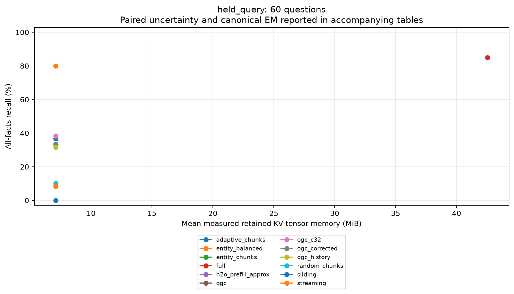
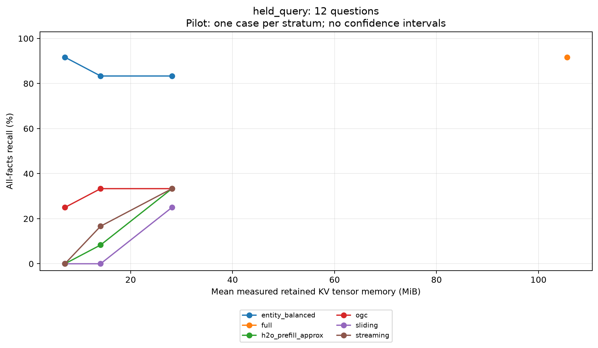
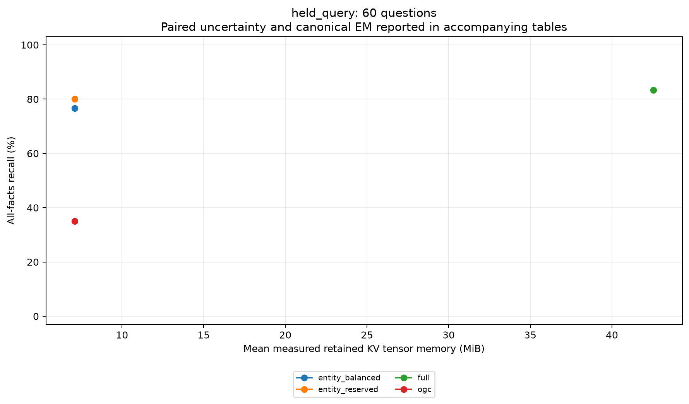
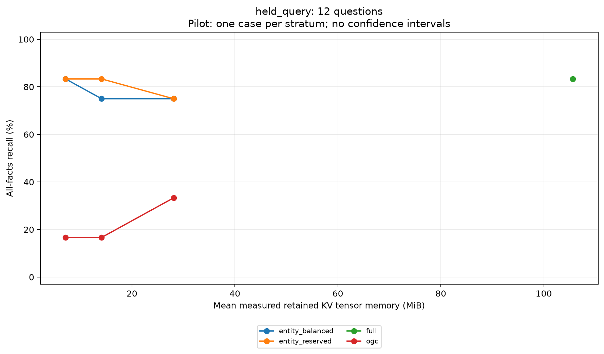

# Phase 3: targeted selection fixes and controlled recall evaluation

Date: 2026-10-31. Base main: `486b9b0`. The pre-existing whitespace edit to
`PHASE2_TEST_REPORT.md` is preserved and excluded from these commits.

## Scope and contribution

This work addresses Phase 2's specific diagnosis; the earlier broad audit was
not repeated. All original policies and artifacts remain available. No frontend
files changed. Experiments use the local pinned Qwen2.5-1.5B-Instruct model,
BF16/eager attention on Apple M5 MPS with 16 GB RAM.
Model/tokenizer revision: `989aa7980e4cf806f80c7fef2b1adb7bc71aa306`;
torch 2.14.1, transformers 5.20.1, prefill blocks of 256, greedy generation with
EOS stopping and a 35-token answer cap. Other version details are in manifests.

The default OGC policy remains unchanged. Experimental methods are opt-in;
synthetic tests and a small long-context pilot do not establish a generally
better default or an accuracy guarantee.

Changed files are limited to:

|Files|Purpose|
|---|---|
|`src/selection.py`, `src/ogc_cache.py`|Opt-in residual scoring, complete-record selection, question-slot reservation|
|`src/generation.py`|Controlled document/query split and measured query/document telemetry|
|`run_research_benchmark.py`|Explicit protocol and matched-budget ablation configurations|
|`verify_phase3.py`, `analyze_phase3.py`|Independent artifact checks, paired contrasts, tables and measured-KV plots|
|`tests/test_phase3.py`, `tests/test_cache_pretrained.py`|Targeted synthetic and pinned-model regressions|
|`PHASE3_PROTOCOL.md`, this report, `README.md`|Frozen design, evidence, limitations and report pointer|
|New `artifacts/phase3-*` directories|Raw outputs, immutable manifests, verification and test logs, derived analyses|

### Sink interference

Original selection adds raw attention over heads and observation queries.
Persistently large attention to formatting/header tokens beyond the four
intentional sinks can therefore win the `[4,68)` history chunk. Those tokens are
not excluded by the original candidate start of four.

`ogc_corrected` subtracts, per layer/head/key, the minimum attention over the
observation queries multiplied by their count. This removes a persistent
attention floor and ranks the nonnegative varying residual. Floors accumulate
correctly across prefill blocks, including causal future-key zeros. It does not
blindly delete early document positions, which could contain real facts. The
four intentional sinks remain explicitly retained. Neutral-score ties favor
later candidates. This corrects a selection mechanism; empirical accuracy gains
are evaluated separately, and negative standalone results are reported.

The standalone correction did **not** improve held-out recall: original and
corrected OGC both scored 33.3% on V1, with paired change 0 pp [0,0]. Their mean
history occupancy of the spatial band [4,68) was also identical, 6.4/64 slots.
This band includes useful instructions, so it is not a semantic measure of
redundancy. A universal early-position exclusion is not justified by this run.

### Complete relationships and dispersed facts

The existing boundary policy splits on punctuation found in decoded individual
tokens and truncates the last selected span to fit capacity. It can split a
sentence at decimal punctuation or fill its budget with short fragments.

The opt-in `entity_balanced` variant uses exact tokenizer offsets and
sentence/newline boundaries, avoiding decimal and identifier punctuation splits.
It prioritizes records containing generic hyphen/underscore identifiers supplied
in the user question, then marginal coverage of query words, then residual
attention. It selects fitting whole records before filling spare slots. This is
a structured-record retrieval heuristic, not a general NER system. It never reads
gold answers, needle offsets or benchmark query-type labels. Oversized records
and residual budget fill cannot be guaranteed atomic.

It allocates half the non-sink capacity to history instead of one quarter:
B=260 gives S=4/H=128/W=128, versus original S=4/H=64/W=192. Multiple dispersed
records can therefore be retained at the same total budget. Matched controls
include original C64/K1, C32/K2, and larger-history C64/K2 at B=260. The latter
isolates history allocation without changing the scoring or grid policy.
No overlapping-window search was added: complete natural records avoid the
fixed-grid failure without enumerating overlapping candidates.

### Protecting records during question ingestion

A deterministic review identified a second boundary problem: a record selected
only as part of the document's recent window can roll out while question tokens
are teacher-forced, before the first answer token. The regression reproduces
loss of a four-token record under unreserved selection.

The separate opt-in `entity_reserved` policy reserves R=min(question tokens,W)
slots first, selecting document history with recent window W-R and document
budget B-R. History capacity stays H; the question fills the reservation, under
the same combined B limit. This protects more near-end records by making them
eligible for history selection. It does not guarantee retention of every fact.
For queries longer than W, older query tokens can still roll out. Initial
document bytes and final combined bytes are recorded separately. V1 unreserved
results remain intact; V2 uses fresh independent seeds and a stricter depth check.

### Question after compression

The `held_query` protocol tokenizes the chat prompt once and partitions it at the
explicit Inquiry boundary. Only document IDs are forwarded during document
prefill. Then the document cache is compressed, question IDs are teacher-forced
one at a time against it, and answer token 1 comes from the last question forward.
The document-prefill logits are not used for the first answer token.

Question tokens count inside the same B budget, with pruning after every forced
query token and every answer step. Absolute positions remain the original full
prompt positions and cached RoPE keys are not rerotated. A forward transiently
holds at most B+1 entries during query/decode. Reservation fills gradually from
min(document tokens,B-R); after the question and during answer decode, retained
tensors have min(consumed,B) entries.
Selectors may read the known question text lexically; no model forward with
question tokens sees the full document cache before compression. This access
model is stated explicitly rather than calling selection query-blind.

The previous `continuation` protocol remains the default for historical
reproduction. Its first answer token still comes from full-prompt prefill logits.
Scores and timings from different protocols are not pooled. Held-query TTFT
includes the separately measured question-forward and question-pruning phases.

## Correctness and regression execution

57 distinct tests passed in isolated test-file executions, including five opt-in
pinned-model checks. Existing test files ran successfully; new tests cover
persistent-floor cancellation, preserved sinks, exact record relationships,
block/dense residual-score equality, final-query first-token use, original
positions, query EOS handling, long-query/100-token decode budget enforcement,
repeatability, tensor shapes and independent byte accounting.

Raw logs are under `artifacts/phase3-validation/`. There were two development
failures, both preserved: one synthetic assertion expected the first token of a
salient region despite a fixed-grid tie selecting its latter half; the corrected
test checks salience versus sink selection while a separate record test checks
atomicity. A strict new BF16 unpruned sequence-parity check against a batched HF
prefill diverged after six matching tokens, including the answer digits. Exact
12-token BF16 parity across batching shapes is not claimed. The final pinned
check verifies first-token parity; full-sequence equivalence is verified on tiny
FP32 Qwen2. The old pinned continuation-parity test still passes. The cause of
the across-batching divergence has not been isolated; dtype/kernel sensitivity
is a hypothesis. Exact BF16 sequence parity remains an unresolved limitation.

Final passing counts: cache correctness 17; Phase 3 targeted tests 10;
benchmark/research 4; pinned-model checks 5; baseline 4; streaming 3; additional
baselines 3; original OGC 3; dataset 4; demo/regression 4. The last six files were
rerun after all timed experiments. The [final evidence index](artifacts/phase3-validation/final-evidence.json)
records exact commands, counts, log hashes and benchmark provenance. Earlier
failed development attempts remain in the same validation directory.

## Experiments and integrity

The frozen [protocol](PHASE3_PROTOCOL.md) declares seeds, configurations, capacity
splits and the success rule before held-out inference. The four development cases
include two known Phase 2 failures and two fresh cases. The main held-out cohort
has 60 independently seeded questions across 1K/2K, five depths, three types,
and two repetitions per cell. The independent 12-case pilot covers 1K/2K/4K/8K
and all three budgets, with singleton intervals withheld.

Both metrics are reported: all-facts boundary matching and normalized canonical
exact match. Paired percentile bootstrap uses 2,000 resamples stratified by
length/depth/type. No multiplicity correction; analyses are exploratory. Repeated
policy evaluations are not extra independent questions. A promising aggregate
score is not evidence of casewise equivalence or general preservation.
All-facts matching requires every gold value but does not penalize extra
unsupported assertions; canonical EM provides a stricter complementary metric.
With only two observations per stratum, these intervals describe the fixed
synthetic design and can underrepresent uncertainty about broader populations.

Every experiment writes a fresh directory containing immutable raw question
outputs, token IDs, document/query/decode cache histories, physical payload and
storage bytes, timing components, version/config/source hashes and status.
`verify_phase3.py` independently checks these against the model geometry and
reconstructs predictions and scores. All original benchmark artifacts remain
unchanged. No result is edited to correct an implementation or scoring failure.

## V1 held-out results: aggregate gain, failed consistency rule

Sixty fresh questions, 1K/2K, B=260, same held-query protocol and paired inputs:

|Policy|All-facts recall %|Canonical EM %|Measured final KV MiB|
|---|---:|---:|---:|
|Full|85.0|40.0|42.5318 mean|
|Original OGC C64/K1|33.3|18.3|7.1094|
|Residual-score OGC|33.3|18.3|7.1094|
|Existing entity chunks|33.3|10.0|7.1094|
|Adaptive chunks|36.7|11.7|7.1094|
|Random contiguous chunks|10.0|3.3|7.1094|
|C32/K2 OGC|38.3|11.7|7.1094|
|Larger-history C64/K2 OGC|31.7|8.3|7.1094|
|StreamingLLM-style|8.3|3.3|7.1094|
|Sliding window|0.0|0.0|7.1094|
|Static H2O approximation|8.3|0.0|7.1094|
|Unreserved records / balanced history|80.0|36.7|7.1094|

Unreserved records improved aggregate recall by 46.7 pp (paired 95% bootstrap
CI [41.7,51.7]) and canonical EM by 18.3 pp [11.7,25.04]. Nevertheless, the
**declared improvement rule failed**: adversarial recall fell from 85% to 75%.
At end depth it fell from 41.7% to 33.3% (full 58.3%). Multi-fact recall rose
from 0% to 80%, and single-fact from 15% to 85%. These mixed results do not
establish a consistently successful method. The V2 reservation correction is
tested separately; this negative V1 result is not replaced.

The original entity-boundary heuristic did not reproduce its Phase 2 diagnostic
gain under this changed protocol and fresh cohort. A Phase 2-versus-Phase 3
percentage comparison would confound both data and protocol. Smaller chunks
alone and increased history alone also failed to resolve multi-fact recall
(5% and 0%, respectively), despite equal total memory.

Full tables, timing components and paired contrasts:
[V1 analysis](artifacts/phase3-held-analysis/phase3-held-60.json),
[raw outputs](artifacts/phase3-held-60/outputs.jsonl).



### V1 independent context/budget pilot

Twelve fresh questions covering nominal 1K/2K/4K/8K; each cell is a singleton,
so these are descriptive point estimates, without uncertainty intervals.

|Policy|B260 recall %|B516 recall %|B1028 recall %|
|---|---:|---:|---:|
|Original OGC|25.0|33.3|33.3|
|Unreserved records|91.7|83.3|83.3|
|StreamingLLM-style|0.0|16.7|33.3|
|Sliding window|0.0|0.0|25.0|
|Static H2O approximation|0.0|8.3|33.3|

Full recall was 91.7%, mean final KV 105.6084 MiB. Compressed final KV was
7.1094/14.1094/28.1094 MiB at B260/516/1028. More retained memory did not
monotonically improve record-selection recall. This is an observed negative
Pareto result, not a reason to select B260 as a generally optimal budget.
The pilot confounds depth and query type by design and cannot validate each
separately. [Pilot tables](artifacts/phase3-held-budget-analysis/phase3-held-budget-12.md)
include measured timings and all methods.



## V2 independent held-out results: reservation correct, consistency still fails

The reservation implementation was frozen at `0c19a41`; all five pinned-model
tests passed before fresh inference. Sixty independently seeded questions use
the same 1K/2K design, B=260, with no overlap with V1.

|Policy|Recall %|Canonical EM %|KV MiB|Prefill ms|Query ms|Selection/pruning ms|TTFT ms|Decode ms|Wall ms|
|---|---:|---:|---:|---:|---:|---:|---:|---:|---:|
|Full|83.3|36.7|42.5327 mean|799.5|1749.4|0.3|2552.5|887.7|3440.6|
|Original OGC|35.0|8.3|7.1094|847.9|1550.9|370.1|2412.4|779.5|3192.1|
|Unreserved records|76.7|35.0|7.1094|821.8|1546.4|379.2|2383.8|829.3|3213.3|
|Reserved records|80.0|43.3|7.1094|840.4|1541.4|128.8|2397.4|782.5|3180.1|

Times are synchronized means of the generation calls, excluding model load and
warmup. Query time contains query pruning; decode time contains decode pruning.
Selection/pruning is a cross-phase total and must not be added again to wall
time. Tokenization, output decoding and generation overhead are included in wall
time; full experiment process lifetime is not. These are exploratory timing
observations, not a controlled throughput or speedup claim.

Reserved records versus original OGC: recall +45.0 pp, paired 95% CI
[38.3,53.3]; canonical EM +35.0 pp [26.7,43.3]. Against **unreserved records**
on these same fresh cases, reservation adds +3.3 pp recall [-1.7,8.3], so a
standalone aggregate recall advantage is not established. EM adds +8.3 pp
[5.0,11.7]. Reservation has a deterministic correctness benefit but does not
guarantee quality gains for every case or subgroup.

|Query type (20 questions each)|Original OGC %|Unreserved %|Reserved %|Full %|
|---|---:|---:|---:|---:|
|Single-fact|20|80|90|85|
|Multi-fact|5|80|85|85|
|Adversarial|80|70|65|80|

The reserved policy passes the paired aggregate bound, context, depth and EM
checks, but **fails the predeclared query-type consistency requirement**. It is
not presented as a consistently successful improvement. Unreserved selection
also fails that requirement on this independent cohort.

|Depth (12 questions each)|Original OGC %|Unreserved %|Reserved %|Full %|
|---|---:|---:|---:|---:|
|Start|41.7|100|91.7|83.3|
|Early-middle|33.3|91.7|91.7|91.7|
|Middle|25.0|91.7|91.7|91.7|
|Late-middle|25.0|66.7|75.0|66.7|
|End|50.0|33.3|50.0|83.3|

The end-depth deficit against full remains substantial. Reservation also reduces
start-depth recall versus the unreserved variant. Per-context reserved recall is
80% at both 1K and 2K; original OGC is 43.3%/26.7%, full 80%/86.7%.

Post-hoc diagnosis reconstructs pre-answer positions from initial retention and
the static pruning rule. Reserved selection retained the complete current and
obsolete records in all 20 adversarial cases before answering; seven answers
were still wrong, six containing the obsolete value. Unreserved selection kept
the current record in 18/20 before answering; original OGC in 15/20. Thus token
presence alone does not explain or solve this regression. Final reserved caches
still contain the complete current record in 18/20, so some recent records can
roll out during the answer. Cached representation effects, instruction retention
and conflict resolution need further investigation; none is established as the
cause here. [Diagnostic records](artifacts/phase3-reserved-held-analysis/adversarial-diagnostics.json)
use gold spans only in post-hoc analysis, never in selection.

Physical accounting: question reservations range 33–45 tokens. Initial document
budgets are 215–227 tokens, with measured K/V bytes 6,164,480–6,508,544. Query
ingestion fills the same final B260 cache: **7,454,720 bytes** of payload and
unique storage for both compressed methods. Full averages 44,598,818 bytes,
with differing output stopping lengths. No full-cache accuracy-preservation
guarantee follows from these aggregate comparisons.

[V2 independent checks](artifacts/phase3-reserved-held-60/verification.json),
[raw outputs](artifacts/phase3-reserved-held-60/outputs.jsonl),
[paired contrasts](artifacts/phase3-reserved-held-analysis/phase3-reserved-held-60.json).



### V2 independent budget/context pilot

Twelve additional fresh questions, same descriptive singleton design:

|Policy|B260 recall %|B516 recall %|B1028 recall %|
|---|---:|---:|---:|
|Original OGC|16.7|16.7|33.3|
|Unreserved records|83.3|75.0|75.0|
|Reserved records|83.3|83.3|75.0|

Full scores 83.3%, mean physical KV 105.6243 MiB. All compressed methods measure
7.1094/14.1094/28.1094 MiB at B260/516/1028. Canonical EM for reserved records
is 41.7/33.3/33.3%; original OGC 0/0/8.3%; full 33.3%.

At B260, original OGC recall is 33.3/33.3/0/0% for 1K/2K/4K/8K; reserved
records and full both score 100/100/66.7/66.7%. Only three questions support
each context point, and depth/type are confounded. Equal aggregates do not prove
casewise equivalence or preservation on a broader population. Increasing B to
1028 again lowers the record method's mean recall. No confidence interval is
reported for singleton strata and no budget is promoted as universally optimal.

[Pilot tables](artifacts/phase3-reserved-budget-analysis/phase3-reserved-budget-12.md),
[raw outputs](artifacts/phase3-reserved-budget-12/outputs.jsonl).



### Completed run inventory

|Artifact directory under `artifacts/`|Questions|Configurations|Raw outputs|
|---|---:|---:|---:|
|`phase3-dev-continuation`|4 development|7|28|
|`phase3-dev-held`|Same 4 development|7|28|
|`phase3-held-60`|60 fresh held-out|12|720|
|`phase3-held-budget-12`|12 fresh held-out|16|192|
|`phase3-reserved-held-60`|60 fresh held-out|4|240|
|`phase3-reserved-budget-12`|12 fresh held-out|10|120|

Total: **1,328 actual outputs**, 144 unique held-out questions plus four
development questions (two reused Phase 2 diagnostics). The four held-out
datasets have disjoint item IDs, seeds and document hashes, with no overlap
against development or the Phase 2 matched input. They share synthetic templates.
[Independence checks](artifacts/phase3-validation/dataset-independence.json).
Development records scored 100% under both protocols; original OGC scored 0%.
Those four diagnostic cases are not included in held-out uncertainty or claims.

## Reproduction

From the repository root with the existing pinned `.venv`:

```bash
.venv/bin/python -m unittest discover -s tests -p test_phase3.py -v
RUN_PRETRAINED_TESTS=1 .venv/bin/python -m unittest discover -s tests -p test_cache_pretrained.py -v

.venv/bin/python run_research_benchmark.py --protocol held_query --seed 2026110401 --lengths 1024 2048 --repeats 2 --budgets 260 --policies full streaming sliding h2o_prefill_approx ogc ogc_corrected entity_chunks entity_balanced adaptive_chunks random_chunks ogc_c32 ogc_history --output artifacts/phase3-held-60-repro

.venv/bin/python run_research_benchmark.py --protocol held_query --seed 2026110501 --dataset artifacts/phase3-validation/budget-pilot-input.json --budgets 260 516 1028 --policies full streaming sliding h2o_prefill_approx ogc entity_balanced --output artifacts/phase3-held-budget-repro

.venv/bin/python run_research_benchmark.py --protocol held_query --seed 2026110601 --lengths 1024 2048 --repeats 2 --budgets 260 --policies full ogc entity_balanced entity_reserved --output artifacts/phase3-reserved-held-repro

.venv/bin/python run_research_benchmark.py --protocol held_query --seed 2026110701 --dataset artifacts/phase3-validation/reserved-budget-input.json --budgets 260 516 1028 --policies full ogc entity_balanced entity_reserved --output artifacts/phase3-reserved-budget-repro

.venv/bin/python verify_phase3.py artifacts/phase3-held-60 artifacts/phase3-held-budget-12 artifacts/phase3-reserved-held-60 artifacts/phase3-reserved-budget-12
.venv/bin/python analyze_phase3.py --studies artifacts/phase3-dev-continuation artifacts/phase3-dev-held artifacts/phase3-held-60 artifacts/phase3-held-budget-12 artifacts/phase3-reserved-held-60 artifacts/phase3-reserved-budget-12 --output artifacts/phase3-analysis-repro

PYTHONPATH=. .venv/bin/python artifacts/phase3-validation/adversarial_diagnostic.py artifacts/phase3-reserved-held-60 --output artifacts/adversarial-diagnostics-repro.json
```

Existing output directories are rejected. Each experiment manifest also records
the exact command actually executed.

## Remaining limits and readiness

No peak-memory reduction has been demonstrated. Full document KV exists during
prefill; scoring is bounded by prefill query blocks, but attention arithmetic
remains quadratic. MPS values are allocation checkpoints, RSS peaks are process
lifetime, and CUDA is unavailable. Retained-KV savings must not be described as
peak-memory savings.

Static H2O remains a clearly labeled approximation; dynamic decode scoring is
not implemented. StreamingLLM-style retention uses absolute RoPE, not the original
paper's positional-shift implementation. Supported verification is one unpadded
Qwen2 DynamicCache sequence with native RoPE; other models, padded batches,
dynamic RoPE scaling and multi-turn adaptation remain unverified.

The combined selector targets queries with explicit structured identifiers and
sentence/record relationships. General natural-language entity resolution,
long/oversized records and many-fact queries need independent validation.
Records crossing the sink/history/recent partition can be clipped, and spare
capacity is filled tokenwise; complete-record retention is not a global guarantee.
Historical chunks remain frozen after selection. The longer-context pilot is
small, and no default change or accuracy guarantee follows from it. The full
300-case all-budget/all-depth matrix has not been rerun in this phase.

The repository is ready for another independent correctness and research audit:
the protocol, raw outputs, negative results, source versions and regression logs
are reviewable. It is **not ready to claim consistent accuracy-preserving
long-context compression**. Both fresh cohorts fail the predeclared query-type
consistency check, the sink correction has no standalone measured gain, and
reservation's standalone recall interval crosses zero. Defaults stay unchanged.

The next audit should prioritize adversarial conflict resolution with retained
current/obsolete records, native BF16 across-batching divergence, and a larger
independent natural-text and 4K/8K matrix. Peak-memory reduction requires separate
measurement and a design that addresses full-document prefill KV.
